# Proxmox VE : infrastructure virtualisée, cluster, HA et automatisation

Projet d'intégration réalisé à l'**ISET Charguia** (Licence RSI, année universitaire 2025-2026).
Mise en place d'une infrastructure de virtualisation complète basée sur **Proxmox VE 9.1** : VMs, conteneurs, cluster multi-nœuds, migration, sauvegarde, haute disponibilité avec Ceph, et automatisation avec Ansible, Vagrant et Terraform.

## Architecture

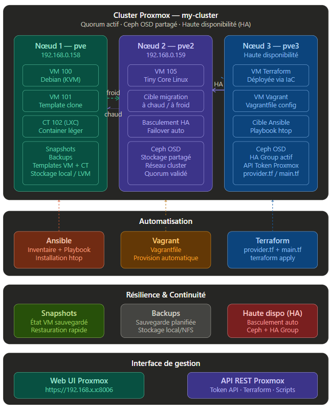

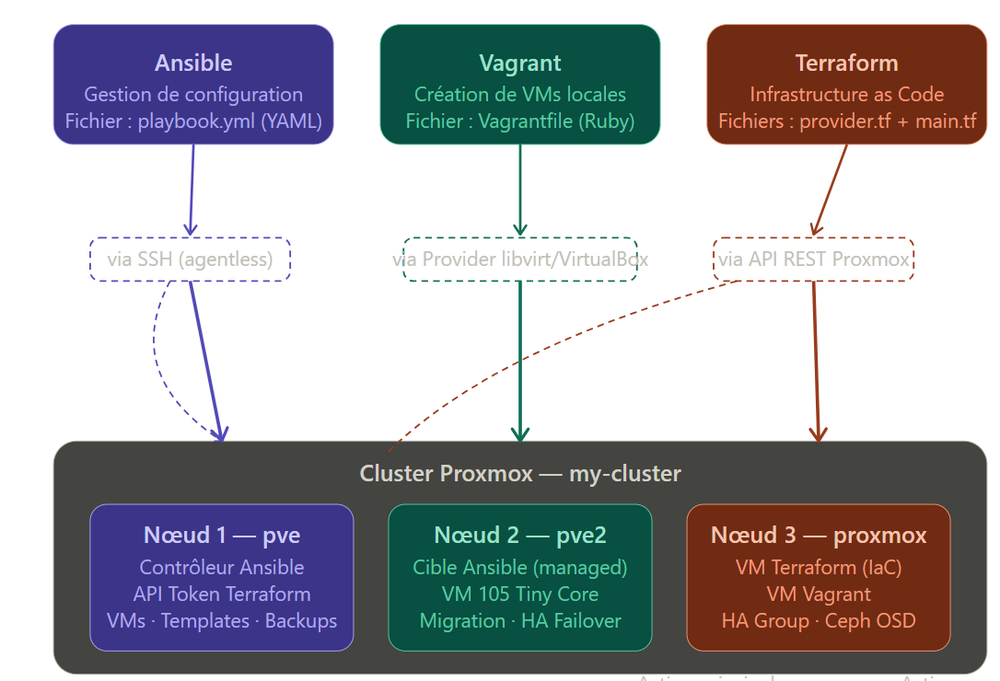

## Technologies

Proxmox VE 9.1 · KVM · LXC · Corosync · Ceph · Ansible · Vagrant · Terraform · VirtualBox · Linux (Debian)

## Étapes réalisées

### 1. Installation et prise en main
- Installation de Proxmox VE sur VirtualBox avec virtualisation imbriquée (nested VT-x)
- Création d'une VM KVM et d'un conteneur LXC (Alpine)
- Création et clonage de templates (VM et conteneur)

| | | |
|---|---|---|
| 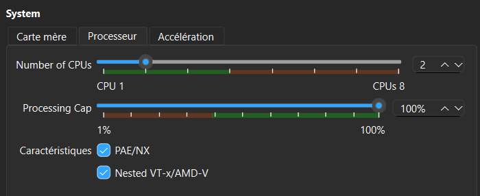 | 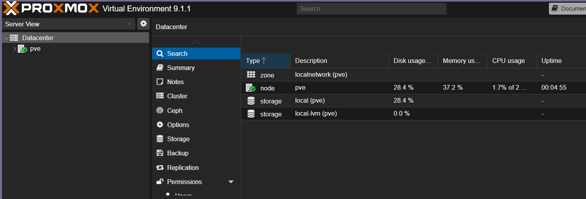 | 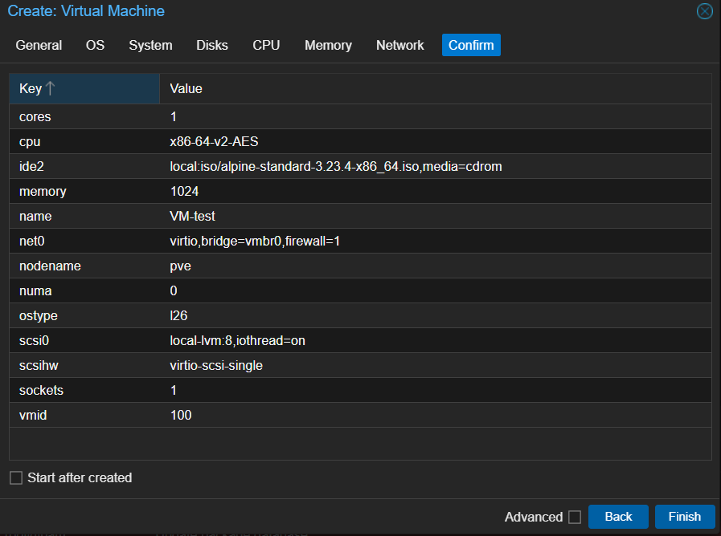 |
| Nested virtualization | Interface web | Création d'une VM |

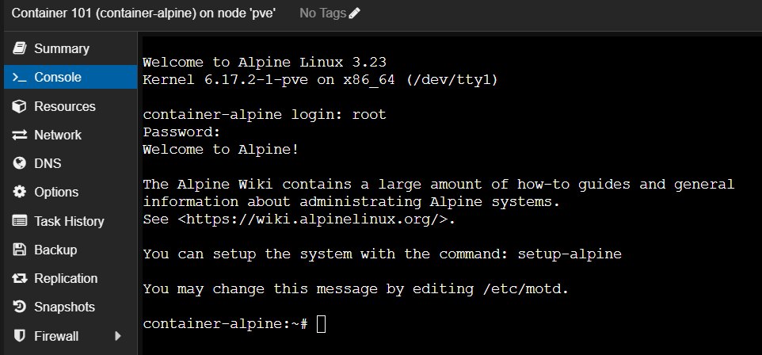

### 2. Cluster et migration
- Cluster `my-cluster` (Corosync), 2 nœuds `pve` et `pve2`
- VM Tiny Core Linux (ID 105) migrée **à froid** puis **à chaud**

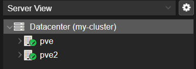
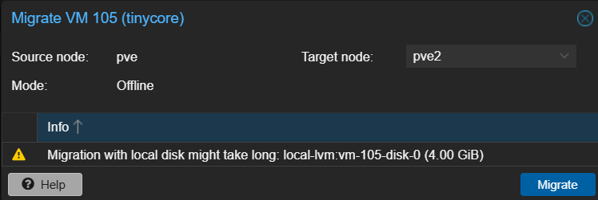
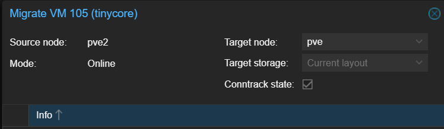

| Critère | Migration à froid | Migration à chaud |
|---|---|---|
| État de la VM | Éteinte | Allumée |
| Interruption | Oui | Non |
| Transfert | Disque complet | RAM synchronisée |

### 3. Snapshots, backups et haute disponibilité
- Snapshots avec RAM, sauvegardes (mode snapshot, compression ZSTD)
- Cluster à 3 nœuds pour le quorum, stockage partagé **Ceph** (OSD sur chaque nœud, pool répliqué ×3)
- VM 105 protégée par HA avec basculement automatique

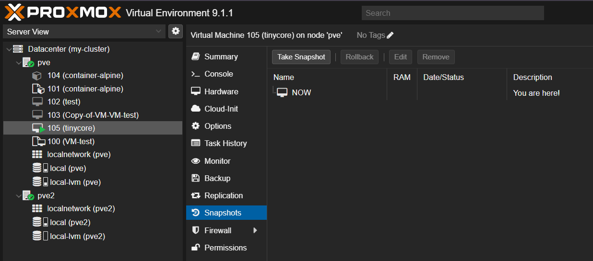
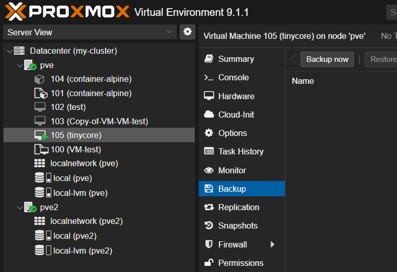
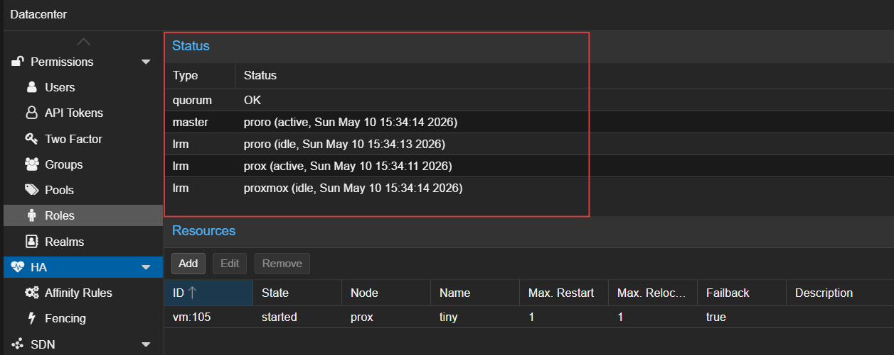
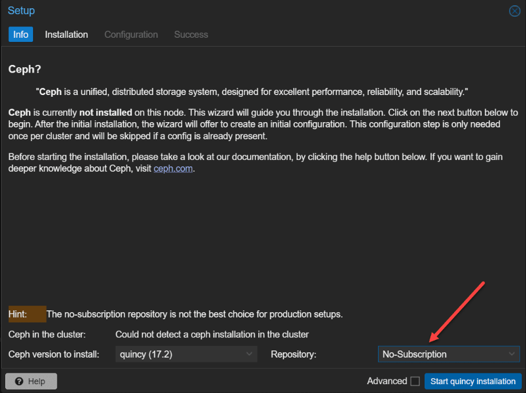
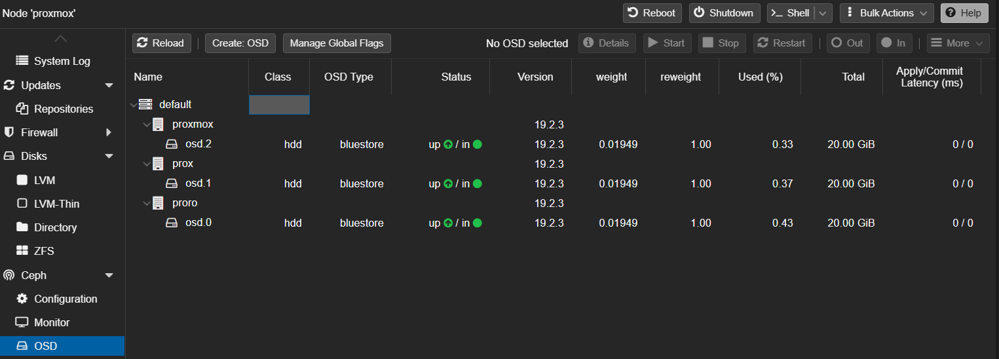

**Test de basculement (nœud défaillant)** :

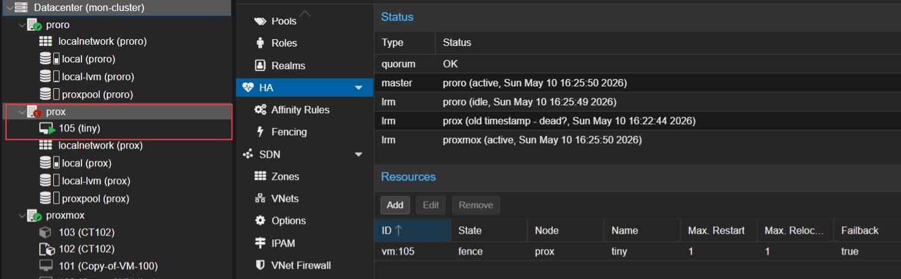
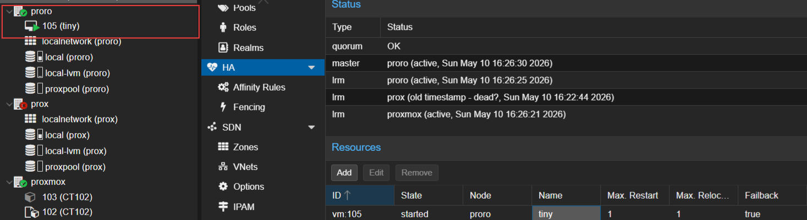

### 4. Automatisation
| Outil | Rôle | Réalisation |
|---|---|---|
| Ansible | Gestion de configuration (SSH, agentless) | Playbook d'installation de `htop` sur pve2 |
| Vagrant | Création de VMs depuis un Vagrantfile | Vagrantfile validé (Debian Bookworm + nginx) |
| Terraform | Infrastructure as Code via l'API Proxmox | VM créée avec `terraform apply` |

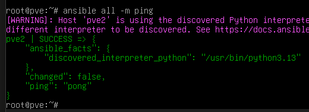
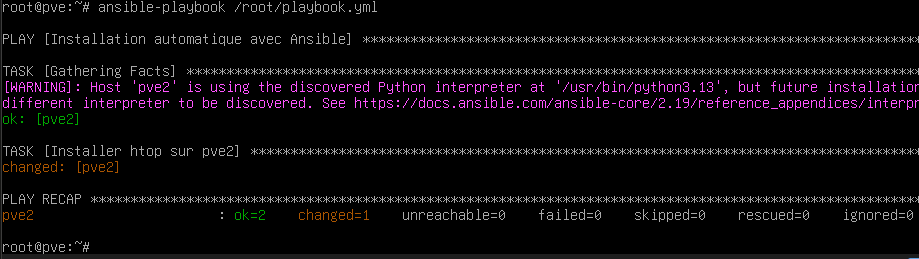
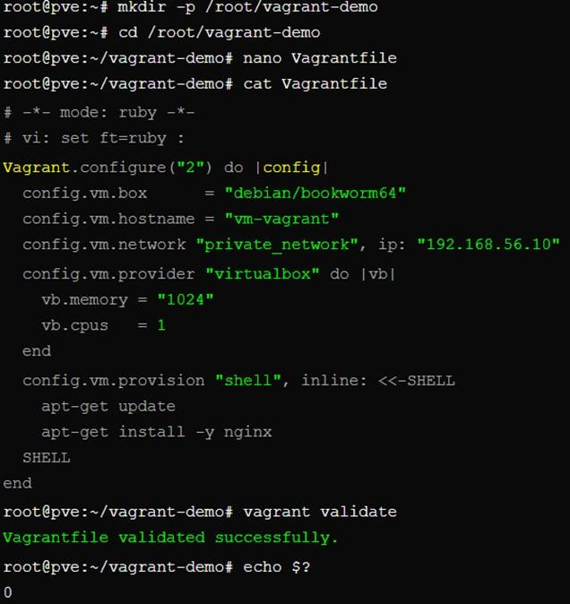
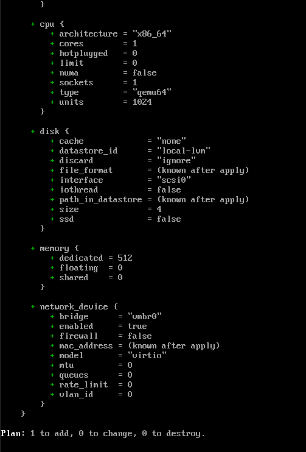
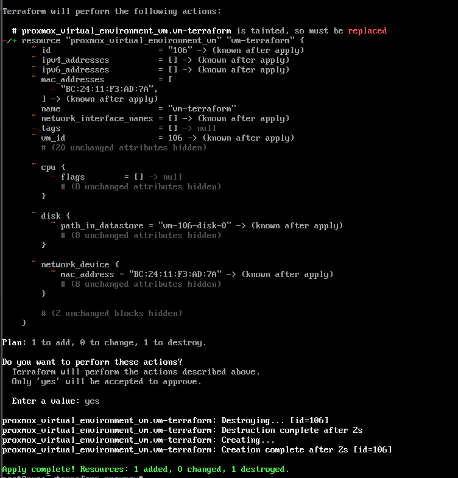

## Problèmes rencontrés et solutions

| # | Problème | Solution |
|---|---|---|
| 1 | Service `networking` inactif après modification de `/etc/network/interfaces` | Redémarrage du service et vérification avec `systemctl status` |
| 2 | Échec du join au cluster (`no quorum`) | `pvecm expected 1` pour forcer le quorum, puis relance du join |
| 3 | Hostname incohérent dans `/etc/hosts` après renommage du nœud | Mise à jour manuelle de la ligne du nœud |
| 4 | IP réelle de `vmbr0` différente de celle utilisée pour accéder à l'interface | Correction de `/etc/network/interfaces` |
| 5 | KVM indisponible en virtualisation imbriquée | `qm set <id> --kvm 0 --cpu qemu64` (émulation QEMU) |
| 6 | Terraform : format `qcow2` incompatible avec LVM-Thin | `file_format = "raw"` dans le bloc `disk` |
| 7 | Terraform : accélération KVM non disponible | Type de CPU `qemu64` dans le bloc `cpu` |

Captures associées : [`docs/screenshots/`](docs/screenshots) (préfixe `6x` et `7x`).

## Compétences acquises

Virtualisation (KVM/LXC) · Clustering et quorum · Migration de VMs · Stockage distribué Ceph · Haute disponibilité · Sauvegarde et restauration · Infrastructure as Code · Dépannage système et réseau

## Contenu du dépôt

```
.
├── README.md
├── .gitignore
└── docs/
    └── screenshots/   # captures du projet
```
